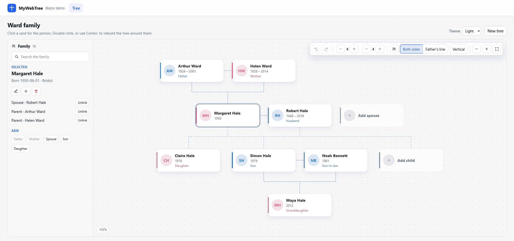
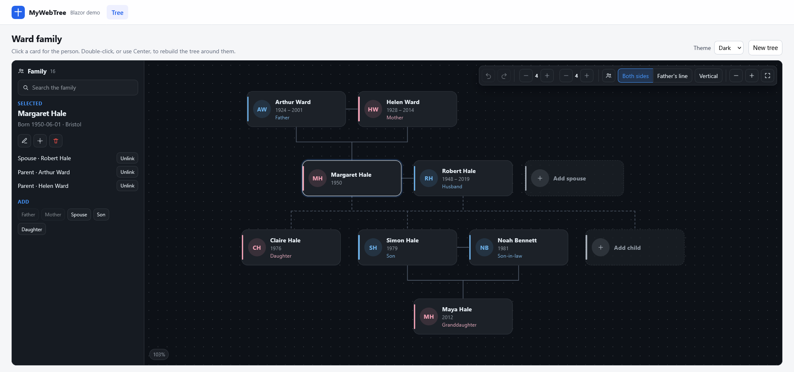

A Blazor family tree for .NET 10. Hand it a list of people and it draws the chart, edits relatives, and hands the change back. Storage is optional: the included service keeps trees in SQLite, SQL Server, PostgreSQL, or MySQL, or the host can keep people in its own database and only use the component.

## Screenshots




Features in this version:

- Pan, zoom, and fit, with ancestry and descendant depth, a vertical or horizontal layout, and a sibling toggle that starts off
- Kinship labels from the person the tree is centered on
- Add a father, mother, spouse, son, or daughter, edit a person, or remove them without removing their relatives
- Link two people already in the tree as parent, spouse, or child. The first stays selected while the second is chosen, and the tree asks before it writes the link
- Unlink a spouse, a parent, or a child and leave both people in the tree. Unlink and delete both ask first
- Undo and redo
- Partial dates: a year, a year and month, or a full day
- Light, dark, auto, and Bootstrap-friendly themes

MyWebTree does not authenticate anyone and does not know about profile pages, uploads, or genealogy file formats. The host decides who may edit, where a person opens, and how a picture is stored.

## Projects

| Project | Purpose |
| --- | --- |
| `MyWebTree.Core` | `PersonData`, `PartialDate`, `FamilyGraphEditor`, and the layout calculator. Depends on Ardalis.Result. |
| `MyWebTree.Data` | Entities and the EF Core model. Tables live in the `webtree` schema. |
| `MyWebTree.Data.Sqlite` | SQLite. Register it with `AddMyWebTreeSqlite()`. |
| `MyWebTree.Data.Sql` | SQL Server. Register it with `AddMyWebTreeSqlServer()`. |
| `MyWebTree.Data.Npgsql` | PostgreSQL. Register it with `AddMyWebTreeNpgsql()`. |
| `MyWebTree.Data.MySql` | MySQL. Register it with `AddMyWebTreeMySql()`. |
| `MyWebTree.Services` | `IFamilyTreeService` and the Extenso repositories. |
| `MyWebTree.Components` | The `FamilyTree` Razor component, its JavaScript and CSS. |
| `MyWebTree.Tests` | xUnit tests for the graph rules, the projection and layout, and a SQLite round trip, including the migration. |
| `MyWebTree.Components.Tests` | bUnit tests for the component: change events, the active family, and undo and redo. |
| `MyWebTree.Demo.Blazor` | Blazor Server demo. |

## How it fits together

`FamilyTree` is given `People` and raises `Changed` with a `FamilyTreeChange`. The graph rules live in `FamilyGraphEditor`, so a card and a saved row cannot disagree. `IFamilyTreeService` is one way to persist that change. A host that already has people uses the component and the editor, and does not have to use the service.

Repositories are Extenso `IRepository<T>` instances bound to `IMyWebTreeDbContextFactory`, not the host's own factory. A host can call `AddEntityFrameworkRepository()` for its own database without MyWebTree reading the wrong one. Services return `Ardalis.Result`.

## Getting started

Reference `MyWebTree.Components` for the UI. Reference `MyWebTree.Services` and one data project when MyWebTree should own the database. Register exactly one of `AddMyWebTreeSqlite()`, `AddMyWebTreeSqlServer()`, `AddMyWebTreeNpgsql()`, or `AddMyWebTreeMySql()`.

```csharp
builder.Services.AddRazorComponents().AddInteractiveServerComponents();
builder.Services
    .AddMyWebTreeServices()
    .AddMyWebTreeSqlite(builder.Configuration.GetConnectionString("MyWebTree"));

app.MapRazorComponents<App>().AddInteractiveServerRenderMode();
```

SQL Server, PostgreSQL, and MySQL use the same call with their own method. Each needs `ConnectionStrings:MyWebTree`. SQLite does not: omit the connection string and it stores `MyWebTree.db` under the user's local application data folder.

```csharp
builder.Services.AddMyWebTreeSqlServer(connectionString);
builder.Services.AddMyWebTreeNpgsql(connectionString);
builder.Services.AddMyWebTreeMySql(connectionString);
```

Add the stylesheet to `App.razor`, and `@using MyWebTree.Components` to `_Imports.razor`:

```html
<link rel="stylesheet" href="@Assets["_content/MyWebTree.Components/mywebtree.css"]" />
```

```razor
<FamilyTree People="detail.People"
            FocusPersonId="@detail.FocusPersonId"
            Theme="auto"
            Changed="OnChanged" />
```

The component must render interactively. `AutoMigrate` is on by default. Set `SeedSample` to create the Ward family when the database has no trees yet.

`Database:Provider` is `Sqlite`, `SqlServer`, `Npgsql`, or `MySql`. The demo reads that value and calls the matching registration method. An unknown name fails at startup.

```json
{
  "Database": {
    "Provider": "Sqlite"
  },
  "ConnectionStrings": {
    "MyWebTree": "Data Source=App_Data/MyWebTree.db"
  },
  "MyWebTree": {
    "AutoMigrate": true,
    "SeedSample": false
  }
}
```

```text
Server=localhost;Database=MyWebTree;Trusted_Connection=True;TrustServerCertificate=True
Host=localhost;Database=MyWebTree;Username=postgres;Password=postgres
Server=localhost;Database=MyWebTree;User=root;Password=root
```

Those three strings are SQL Server, PostgreSQL, and MySQL. Each of those providers has its own migrations. SQL Server, PostgreSQL, and MySQL create the tables in the `webtree` schema. SQLite has no schemas, so that provider ignores the warning and creates the same tables without one. The migrations history table is `__MyWebTreeMigrationsHistory`, in `webtree` where the provider has schemas, so MyWebTree can share a database with the host.

Parameters: `People`, `FocusPersonId`, `Changed`, `Editable` (default `true`), `Theme` (`light`, `dark`, `auto`, `bootstrap`), `Lineage` (`Bilateral` by default, or `Patrilineal`), `ShowSiblings` (default `false`), `Orientation` (`Vertical` by default, or `Horizontal`), `AncestryDepth` and `ProgenyDepth` (generations shown above and below the focus person; `4` by default), `MaxGenerations` (the most the toolbar steppers allow; `8` by default), `DepthsChanged`, `ViewChanged`, `BloodRelativesOnly` (default `false`), `ActiveParentSets` and `ActiveParentSetsChanged` (see [Adopted and foster parents](#adopted-and-foster-parents)), `Height` (default `720px`), `Class`, `Error`, `HighlightedPersonId`, `OnOpenPerson`, `OpenPersonText`, and `ChooseAvatar`. The toolbar can change any of those after the tree opens. `ViewChanged` receives a `TreeView` (generations, siblings, lineage, orientation, and blood relatives only) each time, so the host can remember it (for example in local storage) and pass it back through the matching parameters next time. `DepthsChanged` still receives just the two generation counts. Other attributes are passed to the outer element.

## Integrating with your own people

Use this path when people already live in the host: posts, photos, accounts, or anything else that must not be deleted just because they disappeared from a save payload. Reference `MyWebTree.Components` and `MyWebTree.Core` only. Do not call `IFamilyTreeService.SaveAsync`. That method replaces every relationship in the tree and deletes people who are missing from the list.

Map the host's rows to `PersonData` on the way in. Ids are strings, so a placeholder card that has never been saved can sit beside a real person. `Changed` is the way out.

```razor
<FamilyTree People="people"
            FocusPersonId="@focusId"
            Editable="@canEdit"
            HighlightedPersonId="@currentPersonId"
            OnOpenPerson="OpenPerson"
            OpenPersonText="View profile"
            ChooseAvatar="ChooseAvatar"
            Changed="OnChanged" />
```

### What a change means

`FamilyTreeChange.Kind` says which write to make. `People` is always the whole graph after the edit. `PersonId` is who it happened to.

| Kind | What the host should do |
| --- | --- |
| `Added` | Insert `PersonId` and the links on that card. |
| `Updated` | Update names, dates, places, picture, and notes on `PersonId`. Links did not change. |
| `Removed` | Delete `PersonId` and their links. Relatives stay. |
| `Unlinked` | Remove the link between `PersonId` and `OtherPersonId`. Delete neither person. `Link` says how the other person related to this one. For a parent link, `ParentSetId` and `Type` name the set the parent was taken out of. A set left with nobody in it is gone from `People`. |
| `Linked` | Add the link between `PersonId` (who was selected) and `OtherPersonId` (who was clicked). `Link` is `Parent`, `Spouse`, or `Child`, from the first person to the second. Delete neither person. For a parent link that joined a set the child already had, `ParentSetId` and `Type` name that set. |
| `ParentSetAdded` | A new set of parents was started for `PersonId` (the child) by linking an existing person, `OtherPersonId`, as a parent. `ParentSetId` and `Type` describe the new set. |
| `ParentSetUpdated` | The type, the date, or the primary flag of the set `ParentSetId` of `PersonId` changed. Read the whole child from `People`: when another set stopped being primary, that set changed too. |
| `ParentSetRemoved` | The whole set `ParentSetId` was removed from `PersonId`. The parents stay. |
| `FocusChanged` | Remember the centered person. Nobody's data changed. |
| `Snapshot` | Undo, redo, or any other full replace. Reconcile the host to `People`. |

`FocusChanged` still raises `Changed`, so the host can store the centered person wherever it likes. The component does not use browser storage.

A host written before parent sets existed has no new case to add. `Added` and `Linked` for a parent still mean "this person now has this parent", and `Unlinked` still means "this link is gone". A switch without the three `ParentSet*` kinds ignores them, and can catch up later: `People` is always the whole graph, parent sets included, so reconciling to it (as for `Snapshot`) picks up anything it skipped.

```csharp
private async Task OnChanged(FamilyTreeChange change)
{
    switch (change.Kind)
    {
        case FamilyTreeChangeKind.Added:
            await people.InsertAsync(change.People.Single(person => person.Id == change.PersonId));
            break;
        case FamilyTreeChangeKind.Updated:
            await people.UpdateAsync(change.People.Single(person => person.Id == change.PersonId));
            break;
        case FamilyTreeChangeKind.Removed:
            await people.DeleteAsync(change.PersonId!);
            break;
        case FamilyTreeChangeKind.Unlinked:
            await people.UnlinkAsync(change.PersonId!, change.OtherPersonId!);
            break;
        case FamilyTreeChangeKind.Linked:
            await people.LinkAsync(change.PersonId!, change.OtherPersonId!, change.Link);
            break;
        case FamilyTreeChangeKind.ParentSetAdded:
        case FamilyTreeChangeKind.ParentSetUpdated:
        case FamilyTreeChangeKind.ParentSetRemoved:
            await people.SaveParentSetsAsync(change.PersonId!, change.People.Single(person => person.Id == change.PersonId).ParentSets);
            break;
        case FamilyTreeChangeKind.FocusChanged:
            focusId = change.FocusPersonId;
            break;
        case FamilyTreeChangeKind.Snapshot:
            await people.ReplaceAsync(change.People);
            focusId = change.FocusPersonId;
            break;
    }
}
```

After a successful save, pass the stored people back in through `People`. Ids assigned by the host on `Added` have to be the ids on the next render, or the next edit will not find the person.

`Editable` is one switch for the whole tree. The host sets it from its own roles. There is no per-person permission inside the component.

### Dates

`PartialDate` is a year, an optional month, and an optional day. `new PartialDate(1842)` is a year only. `new PartialDate(1842, 6)` is June 1842. `new PartialDate(1842, 6, 1)` is a full day. `ToString()` returns `1842`, `1842-06`, or `1842-06-01`.

A death is rejected only when the parts both dates actually know say it is earlier than the birth. A year-only death in the same year as a full birth is kept, because the day is unknown.

The editor asks for year, month, and day separately. Month and day can be left blank. A day without a month, or a month without a year, is not saved.

On a card, the lifespan is the years. The side panel shows the full partial date plus birth place and death place.

### Open a person

`OnOpenPerson` shows a button on the selected person. The button is hidden when nothing is listening. `OpenPersonText` defaults to `Open`. The callback receives the `PersonData`. The host navigates to a profile, an editor, or anywhere else.

`HighlightedPersonId` draws a second outline on that card. Use it for the person who belongs to the signed-in user. It does not change who the tree is centered on. `FocusPersonId` does that.

### Pictures

`AvatarUrl` is an address the component puts in an ``. The editor also has a text field for pasting one.

`ChooseAvatar` adds a Choose picture button. The host uploads, or picks from its own store, and returns the address to store. Return null to leave the current address alone. Return an empty string to clear it.

```csharp
private async Task<string?> ChooseAvatar(AvatarRequest request)
{
    string? path = await files.UploadAsync(request.PersonId);
    return path is null ? null : "/uploads/" + path;
}
```

The component does not read the file itself.

### Fields the component stores

`PersonData` carries `Id`, `Gender` (`Unknown`, `Male`, `Female`), `FirstName`, `LastName`, `BirthDate`, `DeathDate`, `BirthPlace`, `DeathPlace`, `AvatarUrl`, `Notes`, the `Spouses` and `Children` id lists, and the parents: `ParentSets`, with `Parents` kept as the members of the primary set.

Names can be 200 characters. Places can be 200. The picture address can be 500. Notes can be 4000. Anything the host keeps beyond that (biography, occupation, account id, map coordinates) stays on the host's own record. Copy it back onto the person when you handle `Updated`, because the component will not round-trip fields it does not know.

### Rules

- A person has at most two parents in any one set, and at most one father and one mother in it. A person can have more than one set.
- A set is never empty, and a person has exactly one primary set. The primary set is the one that decides `Parents`.
- A spouse link and a parent link are stored in both directions.
- Adding a second parent also links those two parents as spouses. Linking an existing person as a second parent does the same.
- Adding a child of someone with exactly one spouse also links that spouse as the other parent. Linking an existing person as a child does not: that spouse can be linked on their own.
- A child cannot be born before a parent. A year-only date in the same year is kept, because the missing part is unknown. Editing a date later is held to the same rule.
- Linking two people as spouses is refused when one died before the other was born.
- Add father and Add mother still refuse a second parent of that role. Linking a parent only refuses a third parent, so two fathers or two mothers are allowed.
- Nobody can be their own ancestor, or married to their own descendant.
- Delete removes the person from every list and leaves the relatives.
- Unlink removes one spouse, parent, or child link. A parent link is one person's membership of one set, so unlinking takes them out of that set only. From the selected person, the side panel lists the families, spouses, and children.
- No two sets of one person have the same members and type. A person can be in the same set as another with a different type (for example both birth and foster parents of the same child), but not twice with the same one.
- Nobody can be their own ancestor through any set, adopted or not.

### Adopted and foster parents

A person's parents are one or more **sets**: the one or two people who parented them in one context. Each set has a `ParentageType` (`Birth`, `Adopted`, or `Foster`), an optional date (of the adoption or placement), and a flag saying whether it is the primary set.

```csharp
var kim = new PersonData
{
    Id = "kim",
    FirstName = "Kim",
    ParentSets =
    [
        new ParentSetData { Id = "kim-birth", Type = ParentageType.Birth, ParentIds = ["bob", "beth"] },
        new ParentSetData { Id = "kim-adopted", Type = ParentageType.Adopted, ParentIds = ["alan", "amy"], Date = new PartialDate(1987) },
    ],
};
```

**Compatibility.** A host that only fills `Parents` and `Children` works exactly as before. The list is read as one primary birth set, nothing new is drawn, and `Changed` carries the same kinds. `Parents` is always the members of the primary set, and `Children` always lists a child once for every set they are in. The component and `FamilyGraphEditor` return people in this normalized shape, with `ParentSets` filled in.

**Which set is primary.** A set flagged `IsPrimary` wins. When none is, the primary set is the first adopted set, then the first birth set, then the first foster set, in the order they are listed. Changing the primary set changes which parents `Parents` reports. Nothing else is deleted.

**What is drawn.** The chart can only draw one person under one set of parents. Each person is drawn under their *active* set, which is their primary set unless the user chose another. A set that is not active is not expanded. When the chart includes those parents, the person appears under them as a *stub*: one card with no ancestry or descendants of its own, a **Switch to this family** button, and **See also** when the person is also drawn in full elsewhere in the chart.

- A child whose link is not a birth link has a small **A** (adopted) or **F** (foster) badge, with the type as its accessible name.
- The line between a child and their parents is solid for birth, dashed for adopted, and dotted for foster. A line to an Add father or Add mother card is a faint solid line, so it cannot be mistaken for an adopted link. Colour is never the only cue.
- A person with more than one set has an **N families** chip. It opens a list of the sets (type, parents, date) with the active one checked. Choosing one redraws that branch in place.
- The side panel lists each set with its type (editable), date (editable), and members, plus **Show in tree**, **Make primary**, and **Remove** when `Editable`.
- Add father and Add mother ask whether to add to a family that has room or start a new one, and what type the new one is. Link parent asks the same. A person with no parents yet only chooses the type.
- `Editable="false"` hides every edit but still lets people switch the active set, because that is only a view.

**The active set is view state.** Switching it does not raise `Changed`, because nobody's data changed. Pass `ActiveParentSets` (person id to set id) to start from a remembered choice, and listen to `ActiveParentSetsChanged` to remember it. It receives the whole map each time, the same way `ViewChanged` works. A missing or out-of-date entry means the primary set. Choosing the primary set removes the entry.

```razor
<FamilyTree People="people"
            ActiveParentSets="activeSets"
            ActiveParentSetsChanged="sets => activeSets = sets"
            Changed="OnChanged" />
```

**Blood relatives only.** `BloodRelativesOnly` hides adopted and foster links, and anyone who can only be reached through them. Each person is drawn under a birth set, or under nobody. The toolbar shows the same switch once the tree has an adopted or foster link.

**Editing in code.** `FamilyGraphEditor` has `AddParentSet`, `SetParentSetType`, `SetPrimaryParentSet`, `SetParentSetDate`, and `RemoveParentSet`. `Link`, `Unlink`, and `AddRelative` take an optional set to join or leave. `TreeProjection.Build` turns the graph into the nodes the layout draws, and is pure.

**Persistence.** `IFamilyTreeService` stores the sets in two tables, `ParentSets` and `ParentSetMembers`. The migration for every provider turns each existing parent row into one primary birth set, then removes those rows from `Relationships`, which holds spouse links only. `SaveAsync` keeps the id of a set that is still there, so a host that remembers `ActiveParentSets` keeps working across saves. Down migrations put each primary set back as parent rows.

## Behaviour

- Click a card to select it and rebuild the tree around them. That is what shows Add father, Add mother, Add spouse, and Add child. Center does the same.
- Link locks that person. The next card, or a search result, is the other end of the link. Confirm writes it. Cancel, or the same Link button again, unlocks the tree.
- Search matches name, lifespan, birth place, and death place.
- Placeholder cards are dashed. Choosing one opens the add form for that relative. A stub card is a second drawing of someone who is shown elsewhere, and is not a placeholder.
- Undo keeps the last 40 edits. Undo and redo raise `Changed` with kind `Snapshot`.
- Depth steppers run from 0 to 8 generations. They only change the drawing, not the data, so they do not raise `Changed`. Neither does choosing another family for someone.
- `IFamilyTreeService.SaveAsync` writes the whole graph: it replaces relationships and deletes stored people who are not in the payload. That is the right save for a tree MyWebTree owns. It is the wrong save for a host whose people have other rows pointing at them.

## Demo

`MyWebTree.Demo.Blazor` runs at https://localhost:7427. It reads `Database:Provider`, uses SQLite when that setting is missing, seeds the Ward family, and saves through `IFamilyTreeService`. Reset demo deletes every saved tree and loads the Ward family again.

## Credits

MyWebTree is derived from [family-chart](https://github.com/donatso/family-chart) by [@donatso](https://github.com/donatso), as such it inherits the MIT license.

## Support

If you find this project useful, consider supporting its development.

<p align="center">
  <a href="https://buymeacoffee.com/vnmatt">
    
  </a>&nbsp;&nbsp;&nbsp;
  <a href="https://www.paypal.com/cgi-bin/webscr?cmd=_donations&business=gordon_matt%40live%2ecom&lc=AU&currency_code=AUD&bn=PP%2dDonationsBF%3abtn_donateCC_LG%2egif%3aNonHosted">
    
  </a>
</p>

<p align="center">
  Prefer using your phone? Scan the QR code:
</p>

<p align="center">
  <a href="https://buymeacoffee.com/vnmatt">
    
  </a>
</p>


